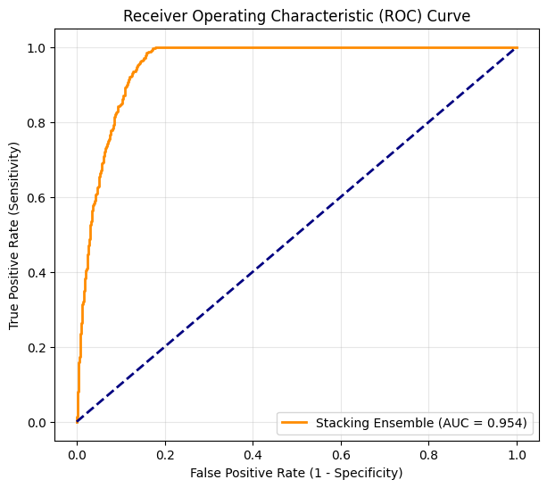
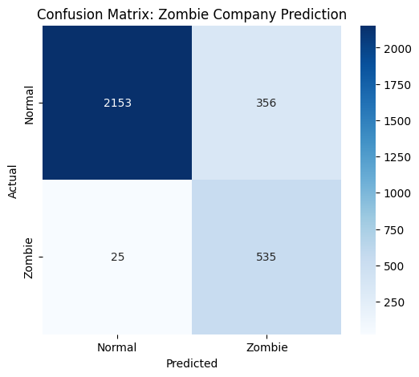

# KOSDAQ zombie firm prediction

Predicting which KOSDAQ-listed companies will be "zombie firms" two years later, using annual
financial statements from 2015 to 2024 (about 14,000 firm-years). I did this project on my own.

## Definition

I counted a firm as a zombie in a given year if its interest coverage ratio (operating profit /
interest expense) was below 1 for three years in a row **and** it posted a net loss for three years
in a row. The target is that status two years after the year the features come from.

Firms that got delisted have missing final years. If the year before was already a zombie year,
I treated the missing years as zombie years too (most likely delisted for financial reasons),
otherwise not.

## Data cleaning

The biggest issue was interest expense, which is needed for the coverage ratio but was missing for
most firm-years. I trained a random forest regressor on the firm-years that had it, using balance
sheet items and pre-tax income (available for all ten years), and used it to fill in the rest.

After that: financial ratios (ROA, operating margin, debt ratio, equity ratio, retained earnings
ratio, current ratio, EBIT to debt, asset and sales growth), winsorizing at 1% / 99%, a VIF check,
log transform for the current ratio and Yeo-Johnson for the growth and margin variables.

## Model

Two base models, logistic regression and XGBoost, trained on an expanding window so there's no
look-ahead:

- train 2016, validate 2017
- train 2016-17, validate 2018
- train 2016-18, validate 2019
- train 2016-19, validate 2020

The out-of-fold predictions from 2017-2020 train a logistic regression (L2) meta-model that
combines the two. 2021-2022 is the test set.

## Results

Validation AUC was between 0.915 and 0.940 in every year, with XGBoost a little ahead of the
logistic model each time.

On the 2021-2022 test set (3,069 firm-years, 560 zombies), threshold 0.5:

| metric | value |
|---|---|
| AUC | 0.954 |
| recall (zombie) | 0.955 |
| precision (zombie) | 0.600 |
| F1 (zombie) | 0.737 |
| accuracy | 0.876 |

 

The model catches almost every zombie but also flags 351 healthy firms. I tried pushing it toward
precision (lower `scale_pos_weight`, stronger regularization): precision went up to 0.84 but recall
dropped to 0.35, with AUC basically unchanged. For an early warning tool I'd keep the high-recall
version. The obvious next step is picking the threshold properly, e.g. maximizing F1 or using a cost
for each type of error.

## Files

```
notebooks/zombie_firm_modeling.ipynb   whole pipeline, run in Colab
figures/                               ROC curve and confusion matrix
```

The raw financial statement files (`{year}_data.xlsx`, keyed by DART corp_code) aren't included.
The notebook reads them from Google Drive.
